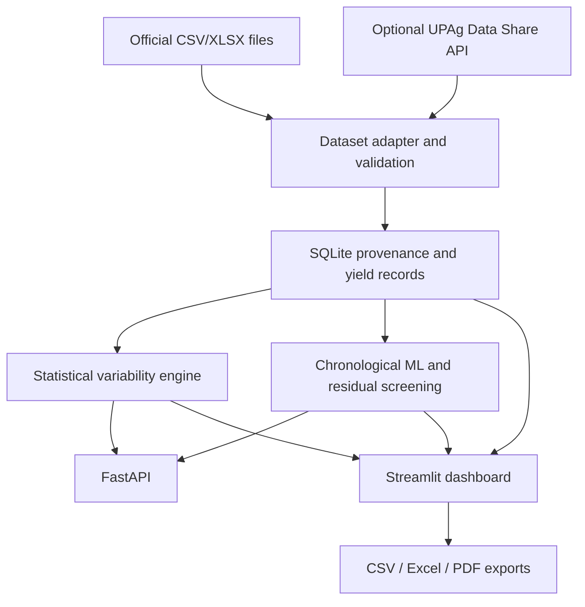

# System Architecture

## Modules

- `audit_data.py`: inventories supplied CSV/XLSX files, headers, types, missing values, zeros, negatives, duplicates, categories, and file hashes.
- `cropwise/dataset_adapter.py`: reads Excel/CSV layouts and standardizes wide/long yield fields without filling missing values.
- `cropwise/service.py`: loads local sources and seeds SQLite from the national annual `Total` series on first use.
- `database/db.py` and `database/schema.sql`: provenance-aware SQLite storage and retrieval.
- `cropwise/analysis.py`: descriptive, trend, detrended, downside, classification, and ranking metrics.
- `cropwise/ml.py`: chronological forecast evaluation, residual anomaly screening, and optional K-Means clustering.
- `cropwise/api.py`: FastAPI endpoints for status, queries, metrics, model screening, and uploads.
- `dashboard.py`: Streamlit views, upload workflow, API connection check, and report exports.
- `api_integration/upag_client.py`: documented bearer-token and paginated source-sharing client; credentials are read from environment variables.

## Data Flow and Fallback

The application works locally without network access or UPAg credentials. A local upload or supplied dataset is validated, then stored with source identity and reporting status. Dashboard views read stored annual observations from SQLite. The recent state and district datasets are currently loaded from their supplied files for their specific pages, not merged into the national long-term series.

The API client never fabricates a live result. Authentication and the allowed-source request require user-provided credentials. The extraction client supports documented paginated source requests, but discovery of each source's business-specific filters and writing a selected live API result to SQLite remains a deliberate operator step.

## Runtime

- Streamlit: `http://localhost:8501`
- FastAPI/OpenAPI: `http://127.0.0.1:8000/docs`
- Default SQLite path: `data/cropwise.sqlite3`
- Configurable paths: `DATABASE_PATH` or `CROPWISE_DB_PATH`
- Credentials: `.env` fields described in `.env.example`
